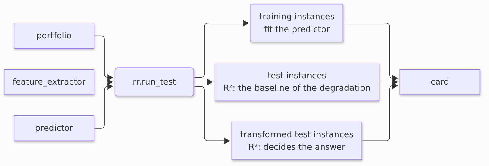
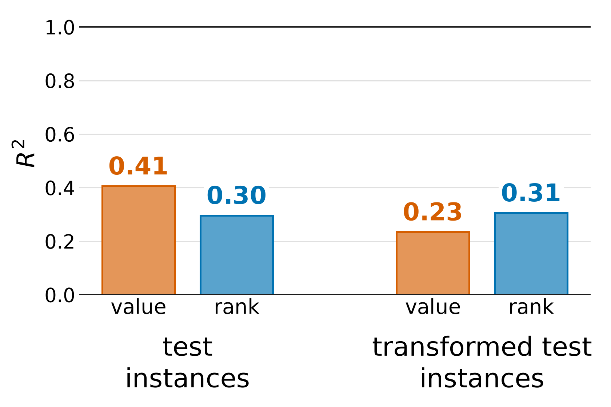
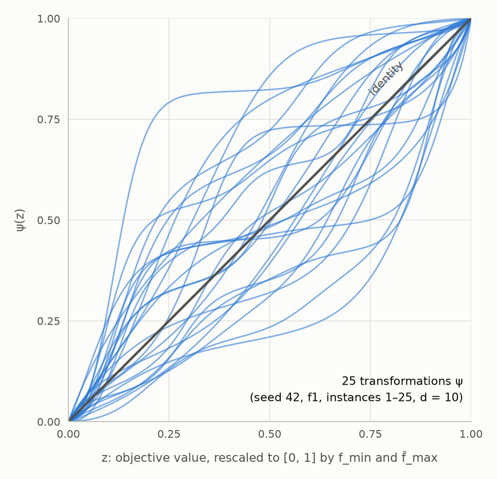

# rubberruler

[](https://pypi.org/project/rubberruler/)
[](https://pypi.org/project/rubberruler/)
[](https://github.com/shuheitnk/rubberruler/actions/workflows/ci.yml)
[](https://github.com/shuheitnk/rubberruler/blob/main/LICENSE)

rubberruler implements the Rubber Ruler Test. Given an algorithm portfolio, a feature extractor, and a performance predictor, it tells you whether to compute the features from the objective values (value-based) or from their ranks (rank-based).

Comparison-based algorithms such as CMA-ES and DE are invariant to strictly increasing transformations of the objective, but features computed from the objective values are not. A performance predictor trained on such features can therefore fail after a transformation, even though the best algorithm stays the same. rubberruler transforms BBOB test instances with random strictly increasing functions, the rubber rulers, and keeps the feature type whose predictions still hold.

<picture>
  <source media="(prefers-color-scheme: dark)" srcset="https://raw.githubusercontent.com/shuheitnk/rubberruler/main/assets/flow-dark.png">
  
</picture>

## Installation

```sh
pip install rubberruler
```

rubberruler requires Python 3.11 or later. The BBOB functions come from [ioh](https://github.com/IOHprofiler/IOHexperimenter), which affects how the installation goes:

- **Python 3.11 and 3.12** on Linux (x86_64), macOS, and Windows: ioh is installed from a wheel, in seconds.
- **Python 3.13 and later:** pip builds ioh from source, which needs a C++ compiler and CMake and takes about five minutes. Without a compiler, install Python 3.12 alongside and use it (on Windows, `py -3.12 -m pip install rubberruler`).
- **Linux on ARM** (aarch64, including Docker on Apple Silicon Macs): pip builds ioh from source on every Python version. Install a compiler first, for example with `apt-get install build-essential cmake`.
- **Windows:** ioh needs the [Microsoft Visual C++ Redistributable](https://learn.microsoft.com/cpp/windows/latest-supported-vc-redist) (X64). Without it, `import rubberruler` fails with an error that says so.

The examples need other packages too; see [Examples](#examples).

## Quickstart

```sh
pip install rubberruler scikit-learn
```

The script below is [examples/quickstart.py](https://github.com/shuheitnk/rubberruler/blob/main/examples/quickstart.py). It defines the three inputs and calls `rr.run_test`:

```python
import numpy as np
from scipy.optimize import Bounds, differential_evolution, minimize
from scipy.stats import kurtosis, skew
from sklearn.ensemble import RandomForestRegressor

import rubberruler as rr


# 1. A portfolio. Each algorithm minimizes `problem`;
#    rubberruler ends the run when the budget is spent.
def random_search(problem):
    rng = np.random.default_rng(problem.seed)
    while True:
        problem(rng.uniform(problem.lower_bounds, problem.upper_bounds))


def de(problem):
    bounds = Bounds(problem.lower_bounds, problem.upper_bounds)
    rng = np.random.default_rng(problem.seed)
    differential_evolution(problem, bounds, maxiter=10**6, polish=False, seed=rng)


def nelder_mead(problem):
    rng = np.random.default_rng(problem.seed)
    x0 = rng.uniform(problem.lower_bounds, problem.upper_bounds)
    minimize(problem, x0, method="Nelder-Mead", options={"maxfev": problem.budget})


portfolio = {"random-search": random_search, "de": de, "nelder-mead": nelder_mead}


# 2. A feature extractor. It receives a sample X and its objective values y,
#    rescaled (value-based) or ranked (rank-based), and returns named features.
#    These four are ELA-style.
def simple_features(X, y):
    def r2_of_fit(design):
        coefficients = np.linalg.lstsq(design, y, rcond=None)[0]
        return float(1 - np.var(y - design @ coefficients) / np.var(y))

    ones = np.ones((len(y), 1))
    return {
        "skewness": float(skew(y)),
        "kurtosis": float(kurtosis(y)),
        "linear_r2": r2_of_fit(np.hstack([ones, X])),
        "quadratic_r2": r2_of_fit(np.hstack([ones, X, X**2])),
    }


# 3. A performance predictor: any regressor with fit and predict.
predictor = RandomForestRegressor(random_state=0)

result = rr.run_test(
    portfolio,
    simple_features,
    predictor,
    # Small settings for a first try.
    # Without them, run_test takes about an hour on a 16-core PC.
    dimension=2,
    budget_per_dimension=100,
    n_runs=5,
)
print(result)
```

With these small settings, it takes about half a minute on 24 CPUs and about five minutes on 2. Progress is shown on stderr, and `print(result)` shows the result:

```text
Rubber Ruler Test: use RANK-based features
  R^2 on the transformed test instances: rank 0.31 > value 0.23

                       R^2 on                       R^2 on
feature type   test instances   transformed test instances   degradation
value                    0.41                         0.23          0.17
rank                     0.30                         0.31         -0.01

With value-based features, the predictor does not generalize to
strictly increasing transformations of the objective.

3 algorithms, 2400 training instances, 240 test instances,
240 transformed test instances
seed=42, dimension=2 (default 10), budget_per_dimension=100 (default 1000),
n_runs=5 (default 31)
```

- The first line is the answer. The second line is the evidence: R² on the *transformed test instances*, which are the test instances with their objective transformed by a random strictly increasing function.
- The table shows R² for each feature type: *value* (y rescaled to [0, 1]) and *rank* (y replaced by its ranks). The *degradation* is the drop in R² from the test instances to the transformed test instances, computed before rounding. It is shown for reference and does not affect the answer.
- The last lines summarize the algorithms, the instances, and the settings. The defaults are the settings used in the paper.

`rich.print(result)` draws the same card in a panel, with the answer and the cautions in color.

The same numbers are saved as a figure, `.rubberruler/rubber_ruler_test.png` and `.svg`:



## Usage

### Inputs

| You pass | rubberruler calls | It returns |
|---|---|---|
| each algorithm in `portfolio` | `algorithm(problem)` | nothing |
| `feature_extractor` | `feature_extractor(X, y)` | `dict[str, float]` |
| `predictor` | `predictor.fit(X, y)`, then `predictor.predict(X)` | a float64 array |

- **Algorithms.** `problem(x)` evaluates one point of shape (d,), or n points of shape (n, d) at once. `problem` also has `dimension`, `lower_bounds`, `upper_bounds`, `budget`, and `seed`. When the budget is spent, the next call ends the run with an exception that `except Exception` does not catch, and rubberruler keeps the best value seen. Algorithms written for IOHexperimenter work without changes.
- **Feature extractors.** `X` has shape (n, d) and lies in the search range, [-5, 5]^d on BBOB. `y` has shape (n,) and lies in [0, 1]. Return the same keys for every instance, and `float("nan")` for a value that cannot be computed.
- **Predictors.** A scikit-learn regressor or `Pipeline` works as it is, and so does any object with `fit` and `predict`. rubberruler fits a copy for each algorithm and feature type: X holds the features of the training instances, and y the performance of the algorithm on them. Set the predictor's own seed, such as `random_state=0`.

### Settings

All arguments of `run_test` except the first three are keyword-only. The defaults are the settings used in the paper, and `help(rr.run_test)` lists the allowed values.

| Argument | Default | Meaning |
|---|---|---|
| `portfolio` | | Algorithm names mapped to algorithms, at least 2 |
| `feature_extractor` | | `(X, y) -> dict[str, float]` |
| `predictor` | | An unfitted regressor with `fit` and `predict` |
| `dimension` | `10` | The dimension d of the BBOB functions |
| `train_instance_numbers` | `range(11, 111)` | BBOB instance numbers of the training instances |
| `test_instance_numbers` | `range(1, 11)` | BBOB instance numbers of the test instances |
| `budget_per_dimension` | `1000` | The budget of one run divided by d |
| `n_runs` | `31` | Runs of each algorithm on each instance |
| `n_samples_per_dimension` | `50` | Sample points for the features divided by d |
| `seed` | `42` | The master seed (not the predictor's `random_state`) |
| `n_jobs` | `-1` | Worker processes; -1 uses every CPU |
| `cache_dir` | `".rubberruler"` | The folder that stores finished runs; `None` stores nothing |

### API

The package exports ten names. Besides `run_test`, each stage of the test is available on its own, and so is the rubber ruler for your own objectives:

| Name | Description |
|---|---|
| `run_test(portfolio, feature_extractor, predictor, ...)` | Run the whole test and return the result; `print(result)` shows the card |
| `bbob_instances(...)` | Create the training, test, and transformed test instances |
| `transform(instance)` | Return the transformed instance, whose objective is g(f(x)) |
| `transform_objective(objective, lower_bounds, upper_bounds, seed=...)` | Return the transformed objective g(f(x)) for your own objective f, with a random rubber ruler |
| `measure_performance(portfolio, instances, ...)` | Measure the performance J of every algorithm on every instance |
| `compute_features(feature_extractor, instances, feature_type, ...)` | Compute the features with one feature type |
| `fit_predictor(predictor, features, performance, instances=...)` | Fit one copy of the predictor per algorithm |
| `r2_score(fitted, features, performance, instances=...)` | Compute R² on the given instances |
| `Problem` | The objective function as an algorithm receives it |
| `RubberRulerError` | The only exception that rubberruler raises |

`result` keeps the performance and the features, so `rr.fit_predictor` and `rr.r2_score` can score another predictor without running the algorithms again ([example](https://github.com/shuheitnk/rubberruler/blob/main/examples/README.md#another-predictor-on-the-same-data)).

### Notes

- **Pre-checks.** Before the main computation, rubberruler runs every algorithm once with a small budget, the predictor once on dummy data, and the extractor on one instance of each function. A problem stops `run_test` there with an `rr.RubberRulerError` of three lines: what happened, `Why:`, and `Fix:`. An algorithm whose short run takes more than 60 seconds also stops it.
- **Caching and resuming.** Finished runs are stored in `cache_dir`. After an interruption (Ctrl+C), run the same call again to resume. If you change the source of an algorithm, even a comment, only that algorithm runs again. Delete the folder to start over.
- **Memory.** Each worker process uses up to a few hundred MB. Pass a smaller `n_jobs` to use less.
- **Progress.** In a terminal or a notebook, the stages are drawn with [rich](https://github.com/Textualize/rich). When stderr is redirected to a file, each stage writes plain lines instead: when it starts, at most every 30 seconds, and when it ends. Set `RUBBERRULER_NO_PROGRESS=1` to hide the progress bars.
- **Docker on Windows and macOS.** Keep `cache_dir` inside the container or in a named volume. In a folder shared with the host, runs are several times slower.
- **Augmentation.** `rr.transform_objective` applies a random rubber ruler to any objective, to augment your own training data ([example](https://github.com/shuheitnk/rubberruler/blob/main/examples/README.md#augmenting-training-data)).
- **Reproducibility.** With the same package versions, the table repeats to the last digit on Linux and Windows. On macOS (Apple Silicon), it can differ from the third decimal place; in our checks, the card stayed the same.

## How it works

`run_test` runs in four stages, which its progress output also shows. The numbers below are the defaults.

1. **Preparing instances.** The training instances are BBOB instances 11 to 110 of all 24 functions, and the test instances are instances 1 to 10. Each test instance also has a transformed test instance, whose objective is g(f(x)). The function g rescales f to [0, 1] by its optimum and the largest of 10,000 random values, then applies ψ, a random strictly increasing function: the rubber ruler. Above that largest value, g only rescales, so g is strictly increasing everywhere.
2. **Measuring performance.** Every algorithm runs 31 times on every instance with a budget of 1000·d evaluations. Its performance J on an instance is the probability that one of its runs beats a run of another algorithm (a tie counts as half), averaged over the other algorithms.
3. **Computing features.** The extractor receives 50·d uniform random points X and their objective values y, once for each feature type. Value-based: y rescaled to [0, 1] by its minimum and maximum. Rank-based: the ranks of y divided by n, with ties sharing their average rank.
4. **Fitting predictors and scoring.** For each feature type, one copy of the predictor per algorithm learns J from the features of the training instances. R² is then computed over all pairs of instance and algorithm, on the test instances and on the transformed test instances.

**The answer is the feature type with the higher R² on the transformed test instances.** A tie selects rank, which loses nothing.

The transformation keeps the order of any two objective values. A comparison-based algorithm therefore makes the same moves, and its J stays the same (unless it stops on differences of values, as Nelder–Mead does). Rank-based features stay the same too, while value-based features change with the transformation, so the predictor receives inputs unlike those it learned from.

The degradation does not decide the answer: rank-based features do not change under the transformation, so their degradation is about 0 by construction, even when they predict poorly. R² on the transformed test instances compares what each feature type actually achieves.

The card marks the answer as weak when the two R² values differ by less than 0.01, or when both are below 0.1. In the second case, improve the extractor or the predictor before choosing a feature type.

Each test instance has its own rubber ruler; the figure shows 25 of them:

<picture>
  <source media="(prefers-color-scheme: dark)" srcset="https://raw.githubusercontent.com/shuheitnk/rubberruler/main/assets/transformations-dark.png">
  
</picture>

## Examples

[examples/](https://github.com/shuheitnk/rubberruler/tree/main/examples) has runnable scripts, and [examples/README.md](https://github.com/shuheitnk/rubberruler/blob/main/examples/README.md) shows how to connect other tools:

| Tool | What it provides | Note |
|---|---|---|
| [ModularCMAES](https://github.com/shuheitnk/rubberruler/blob/main/examples/README.md#modularcmaes) | CMA-ES variants | |
| [ModDE](https://github.com/shuheitnk/rubberruler/blob/main/examples/README.md#modde) | DE variants | |
| [pymoo](https://github.com/shuheitnk/rubberruler/blob/main/examples/README.md#pymoo) | GA, PSO, and more | |
| [pycma, Nevergrad](https://github.com/shuheitnk/rubberruler/blob/main/examples/README.md#pycma-and-nevergrad) | CMA-ES and more | |
| [pflacco](https://github.com/shuheitnk/rubberruler/blob/main/examples/README.md#pflacco) | 55 ELA features | Python 3.11 only |
| [DeepELA](https://github.com/shuheitnk/rubberruler/blob/main/examples/README.md#deepela) | 48 learned features | Installed from GitHub; d ≤ 11 |
| [PyTorch](https://github.com/shuheitnk/rubberruler/blob/main/examples/README.md#pytorch) | A neural network as the predictor | |

## Versioning

rubberruler follows [Semantic Versioning](https://semver.org/). A change that can change the answer for the same inputs comes with a new major version (a new minor version while the version is 0.x) and is marked in the [changelog](https://github.com/shuheitnk/rubberruler/blob/main/CHANGELOG.md). Keep the version with your results: `importlib.metadata.version("rubberruler")` returns it.

## Citation

If you use rubberruler in your research, please cite it with [CITATION.cff](https://github.com/shuheitnk/rubberruler/blob/main/CITATION.cff). On GitHub, "Cite this repository" in the sidebar gives it in APA and BibTeX.

## Development

rubberruler uses [uv](https://docs.astral.sh/uv/) for development:

```sh
git clone https://github.com/shuheitnk/rubberruler.git
cd rubberruler
uv sync
uv run pytest
```

`uv sync` installs rubberruler with the development dependencies, and `uv run pytest -m "not slow"` skips the slow tests. CI also runs `uv run ruff format --check`, `uv run ruff check`, and `uv run pyright`. To run the quickstart, use `uv run python examples/quickstart.py`.

## License

rubberruler is released under the [MIT License](https://github.com/shuheitnk/rubberruler/blob/main/LICENSE).
