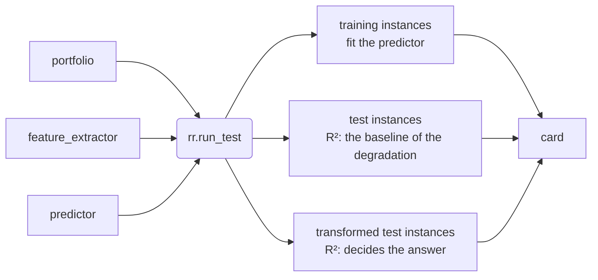

# rubberruler UI/UX Design

- Version: 1.1 (2026-10-14; version 1.0 of 2026-09-29 by Shuhei, translated into English and brought up to date with 0.1.0).
- The single source of truth for the specification is `spec.md` in the same folder. This document explains, from the standpoints of human factors and software engineering, **why** its rules on the user experience are as they are. Where the two disagree, `spec.md` is correct.
- The steps of the implementation are in `implementation.md`, and the record of decisions in `decisions.md`.

---

## 1. Goals and Premises

The goal of the user experience of rubberruler: a first-time user sees the first card within 10 minutes, and no production run of several hours is ever wasted.

The only purpose is to answer, with the least effort, "should your portfolio use value-based or rank-based features?", and the library has no functionality that the answer does not need (Made to Stick and The Elements of Style). Your only task is to match three input and output types.

The user interface of this library is not a screen but the Python API, the output in the terminal, the error messages, and the documentation. This document therefore treats the API as a tool that you operate and designs it from the following standpoints.

| Standpoint | Framework | Question answered in this document |
|---|---|---|
| Human factors | Norman's gulfs of execution and evaluation, cognitive load, the classification of errors (slips and mistakes) | Do you know what to do? Can you read the result correctly? Is it hard to make mistakes? |
| Software engineering | APIs that are easy to use and hard to misuse (Bloch), the principle of least astonishment, progressive disclosure, SemVer | Can you read the code you wrote? Is it robust? Will it last? |
| Evaluation | The cognitive dimensions of APIs (Green and Petre, Clarke) | Does the design meet its aims, and how is that checked? |

---

## 2. Users and the Flow of Use

The main target of the design is the practitioner. The wishes of researchers and contributors are met only where they do not harm the ease of use for practitioners.

| User | Has | Wants to know | Cannot accept |
|---|---|---|---|
| Practitioner (main) | Their own portfolio, feature extractor, and predictor; no need to know the internals of BBOB or ELA | Whether to use value or rank, and why | A failure after hours of running; a result that cannot be read |
| Researcher | The settings of their own experiments | That the same call gives the same result | Randomness that cannot be reproduced; hidden settings |
| Contributor | This repository | Where to make a change | A structure in which breakage goes unnoticed |

The use of a practitioner has five stages. The problems of each stage correspond to the chapters of this document.

| Stage | Action | Likely problem | Design |
|---|---|---|---|
| 1. Learn | Read the README | Not knowing whether it is relevant | Chapter 8 (the opening and the minimal example) |
| 2. Try | Pass the three components and run with small settings (such as `budget_per_dimension=100`) | The form of a function does not match; not knowing where it failed | Chapters 4 and 6 (pre-checks) |
| 3. Production | Run for hours with the default settings | Not knowing when it ends; a crash in the middle | Chapter 5 (plan and progress), Chapter 6 (resumption) |
| 4. Read | Read the card | The meaning of the numbers; what to do when the difference is small | Chapter 5 (the card) |
| 5. Use | Build your own automated algorithm selection with the selected feature type; try another predictor | Running the same benchmark again is expensive | Chapter 3 (component functions), Chapter 7 (cache) |

---

## 3. Mental Model and Progressive Disclosure

The model you are asked to hold is one sentence: "the predictor is fitted on the training instances, R² is measured on the test and the transformed test instances, and the feature type with the higher R² on the transformed test instances is used." The function names, the card, the docstrings, and the error messages can all be explained with the words of this sentence alone (Norman's system image matches the user's model).



R² on the test instances is reported only as the baseline of the degradation; R² on the transformed test instances decides the answer. The opening of the README shows the same figure, so that the first picture you see is the same everywhere.

The API has three layers, and you descend to a lower layer only when you need it. Each layer involves at most four concepts at a time (Cowan's finding that working memory holds 4 ± 1 chunks).

| Layer | What you use | Concepts you keep in mind | When to descend |
|---|---|---|---|
| 0 | `rr.run_test(portfolio, feature_extractor, predictor)` | The three inputs and the result | First use |
| 1 | Keyword arguments (`dimension`, `budget_per_dimension`, `n_runs`, `seed`, `n_jobs`, `cache_dir`, and so on; the defaults are the settings of the paper) | Scale and computing resources | You want to adjust the time or the settings |
| 2 | The six component functions (from `bbob_instances` to `r2_score`) | Instance sets, performance, features, fitted predictors | You want to try another predictor on the same performance data |

`transform_objective` is outside these layers: it is a tool for acting on the answer, with which you augment your own training data (spec 6.7; D43). The private modules that start with `_` are for contributors only.

Descending a layer never repeats a computation. `RubberRulerResult` keeps the intermediate results and passes them to the functions of layer 2 as they are.

```python
result = rr.run_test(portfolio, simple_features, RandomForestRegressor(random_state=0))

# Descend to layer 2 and try another predictor on the same performance data
features = result.features["rank"]
fitted = rr.fit_predictor(GradientBoostingRegressor(random_state=0), features, result.performance,
                          instances=result.split.train)
rr.r2_score(fitted, features, result.performance, instances=result.split.transformed_test)
```

---

## 4. Narrowing the Gulf of Execution

The distance from what you want to do to the code you write is shortened by accepting what you already have.

### 4.1 Form of the Arguments

- The only required arguments are `portfolio`, `feature_extractor`, and `predictor`. All others are keyword-only (after `*`), so you do not need to remember the order of arguments.
- Settings are explicit keyword arguments only (`dimension`, `budget_per_dimension`, `n_runs`, `train_instance_numbers`, and so on). The defaults are the settings of the paper, and there are no presets or setting objects. IDE completion works, and a typo is found by the type check before the run. The list of arguments is in 5.2 of `spec.md`.
- Names include their unit (`budget_per_dimension`, `n_samples_per_dimension`), so that "is 1000 the total or per d?" never arises.
- There are no Boolean or mode arguments that switch behavior. Without switches, there is no choice to remember.

### 4.2 Accepting What You Already Have

| Object | Accepted form |
|---|---|
| `portfolio` | `dict[str, function]`. A function has the single form `algorithm(problem)`. `problem` also has the names of IOHexperimenter's problems, so functions written for ioh work as they are |
| `feature_extractor` | A function that receives `(X, y)` and returns a dict of features. A function of another form is connected by a one-line lambda |
| `predictor` | An unfitted regressor with `fit` and `predict` (the scikit-learn form) |

Each input has exactly one form. With one form, there is one thing to remember. A function of another form is wrapped by you in a one-line lambda. The API has no dedicated adapters per optimizer or feature library; the one line is in the how-to guides of `examples/README.md`.

### 4.3 Types and the IDE

- `rr.Problem`, the type of the argument of an algorithm, is public, and `py.typed` is shipped. `run_test` has type annotations, so pyright points out a type mismatch at the call without any import on your side. Only the predictor is not checked statically, so that scikit-learn's `Pipeline` is not rejected by mistake; the pre-check checks it instead.
- The first line of a docstring starts with the symbol of the paper (for example, `r2_score`: "R^2_tau(Q): how well the fitted predictor predicts J on the instances Q."). Hovering connects the paper and the code.

### 4.4 Consistency with the Ecosystem (Principle of Least Astonishment)

- The predictor follows the conventions of scikit-learn. A passed regressor is used through `clone`, and your object is not modified.
- Tables are returned as pandas DataFrames. The row names are `instance_id`, and the column names are algorithm names or feature names. The performance is the "instance × algorithm" matrix that is standard in algorithm selection.
- Randomness is controlled by a single `seed: int`. The default is 42, and the same `seed` gives the same result. The docstring states that it is separate from the `random_state` of scikit-learn (you set the randomness of the predictor).
- The result is an immutable dataclass. Functions do not modify their arguments and keep no global state except the cache.

---

## 5. Narrowing the Gulf of Evaluation

You are always told what is happening and what the result means, at three points: before, during, and after the run.

### 5.1 Before the Run: the Plan

Before the computation starts, one line states how many runs will be executed. The progress bar shows the remaining time.

```
rubberruler: 267,840 runs (223,200 cached, 44,640 to run) in .rubberruler/
```

### 5.2 During the Run: Stages and Progress

- The processing has four stages, and their names are shown: `[1/4] Preparing instances`, `[2/4] Measuring performance`, `[3/4] Computing features`, and `[4/4] Fitting predictors and scoring`.
- The heavy stages show a progress bar and the remaining time. rich draws them in a terminal and in Jupyter: a spinner while a stage runs and a check mark when it ends. When stderr goes to a file, each stage writes plain lines instead, at most every 30 seconds, so that a log stays short and readable. The output goes to stderr and leaves stdout clean.
- No argument switches the amount of output. To hide the bars, set the environment variable `RUBBERRULER_NO_PROGRESS=1`. Details go to the standard `logging` (the logger `rubberruler`).

### 5.3 After the Run: the Card

The card is ordered answer, evidence, meaning, and conditions, so that a reader of the first line alone receives the answer. The exact form is in 3.2 of `spec.md`.

```
Rubber Ruler Test: use RANK-based features
  R^2 on transformed test: rank 0.63 > value 0.42

feature type   R^2 (test)   R^2 (transformed test)   degradation
value                0.71                     0.42          0.29
rank                 0.66                     0.63          0.03

With value-based features, the predictor does not generalize to
strictly increasing transformations of the objective.

3 algorithms, 2400 train, 240 test, 240 transformed test
seed=42
```

- The width is at most 80 characters. Numbers have two decimal places and are right-aligned. The characters are ASCII, and the text has no color (it reads the same in every terminal and in a log). `rich.print(result)` draws the same parts in a panel with color, for those who want it.
- `seed` and the settings that differ from the defaults are listed in the last line (for example, `seed=42, dimension=20 (default 10)`). The card shows whether the result comes from small settings.
- When the two R² values on the transformed test instances are equal to two decimal places, three decimal places are shown. If the difference is below 0.01, the answer is still given, with one added line of the form `The difference is 0.0042 (below 0.01), so treat this answer as weak.` (10.4).
- Warnings are not printed during the run but counted together below the card (for example, `2 runs failed; their best value so far was used (+inf if none) (see the log)` and `12 instances have NaN features`). All kinds are in 5.6 of `spec.md`.
- Jupyter shows the same text. To record the numbers, use `result.table` (a DataFrame).

---

## 6. Preventing and Recovering from Errors

The most expensive failure is a mistake found after hours, so every component is tried within seconds before the heavy computation.

### 6.1 Pre-checks (Fail Fast)

`rr.run_test` runs the following checks automatically every time before the heavy computation. The component functions check the inputs they use in the same way. There is no function or argument for the checks.

| Object | Checked |
|---|---|
| Each algorithm | It completes a run on one instance with a small budget, evaluates the objective function at least once, and can be sent to another process (it can be pickled) |
| Feature extractor | It can be called for both value and rank, returns the same feature names for both feature types, and returns numbers |
| Predictor | It has `fit` and `predict` and is not the class itself. `fit` and `predict` work on small dummy data |

The settings (such as disjoint instance numbers for training and test and a writable cache location) are checked by the checks of the settings, before the pre-checks.

### 6.2 Format of Error Messages

Every error is written in three lines: what happened (and where), why it is a problem, and how to fix it. "Where" contains the clues that lead you to your own code, such as the algorithm name, the `instance_id`, and the feature type.

```
rubberruler.RubberRulerError: feature_extractor returned 14 features on f05_i003_d10 (rank) but 16 on f01_i011_d10 (rank).
Why: every instance must give the same features.
Fix: return a dict with fixed keys; use float("nan") for values you cannot compute.
```

There is one exception, `RubberRulerError`. The exception at the end of the budget is not for you to catch, so it is not public and derives from `BaseException`.

### 6.3 The Border Between Errors and Warnings

- **Stop with an error**: when the result would be wrong. The keys of the features differ, an algorithm never evaluates in the pre-check, features and a fitted predictor of different feature types are combined, there is no answer (R² is nan), and so on.
- **Continue with a warning**: when the result is correct but may differ from your intention. Features with NaN, a function cached by its name only because its source is not available, a predictor with `random_state=None`, and so on.
- **Failure of a single run**: the run is recorded with the smallest value so far (+inf without any evaluation), the computation continues, and the count appears below the card. The details of the first 10 failures go to the log.

### 6.4 Interruption and Resumption

- Finished runs are written to disk in small batches. On Ctrl-C, the batch in progress is saved before stopping.
- On a stop, one line states the number of saved runs and how to resume (`rubberruler: stopped. 240,000 of 267,840 runs are saved. Run the same call again to resume.`).
- To resume, run the same call again. No special argument is needed.

---

## 7. Settings, Reproducibility, and Cache

The same call returns the same card, whenever, wherever, and with however many workers it runs. You only need to remember this promise and do not need to think about settings or the contents of the cache.

### 7.1 Settings

- The only entry point for settings is keyword arguments. The defaults are the settings of the paper; there are no presets and no configuration files.
- The settings actually used remain in `result.config` (a dict). `rr.run_test(..., **result.config)` runs the same settings again.

### 7.2 Reproducibility

- The randomness of each run is determined by the instance, the algorithm name, and the run number, not by the number of workers or the order of execution. `n_jobs=1` and `n_jobs=32` give the same result.
- The randomness of the predictor belongs to you, so rubberruler does not touch it. If a regressor without a set `random_state` is passed, a warning states that the result cannot be reproduced.

### 7.3 Cache

- The default location is `.rubberruler/` in the current directory. Copied as a whole folder, it works on another machine.
- When you modify a function, only that function is computed again, automatically. A function is identified not only by its source but also by its default values, its closure values, your functions that it calls, and the versions of libraries (D22). A function that cannot be fully identified triggers a warning. The numbers "cached" and "to run" in the plan line show what will be computed again.
- There are no functions that inspect or delete the cache. To delete it, delete the folder `cache_dir`.

---

## 8. Design of the Documentation and the Learning Curve

The documentation is divided into the four kinds of Diátaxis, so that you can enter from your current purpose. In the first release, the four kinds are sections of the README, and only the how-to guides per tool are in `examples/README.md` (D42). There is no documentation site (to save the work of building and maintaining it).

| Kind | Your purpose | Content |
|---|---|---|
| Tutorial | The first success | Quickstart of the README: run `examples/quickstart.py` with small settings and read the card |
| How-to | Connecting what you have | Usage › Inputs of the README (the three types) and `examples/README.md` (installation and code for ModularCMAES, ModDE, pymoo, pycma, Nevergrad, pflacco, DeepELA, and PyTorch; connecting a function of another form with a one-line lambda; filling NaN with a `Pipeline`; another predictor on the same data; augmenting training data). Resuming after an interruption is in Usage › Notes of the README |
| Reference | The exact specification | The docstrings (each starting with the symbol of the paper, with the accepted values) and the tables of Usage › Settings and Usage › API of the README (the 10 names and the arguments) |
| Explanation | Why it works this way | How it works of the README: the four stages, why the measurement uses strictly increasing transformations, why the degradation does not decide, and the figure of the rubber rulers |

- The order of the sections of the README and its writing rules follow Chapter 8 of `spec.md` (opening → Installation → Quickstart → Usage → How it works → Examples → Versioning → Citation → Development → License). The main path (installing, the quickstart, and how to read the card) comes first, notes for only some environments go to Installation, and details per tool go to `examples/README.md`.
- The code of the README and of `examples/README.md` runs in CI, so the examples never go stale. The tutorial (the first answer) runs with the small settings, and its card must be the same, to the character, as the card shown. The other code is checked to run with the smallest settings. When an upgrade of a dependency changes the numbers, the card of the README is pasted again (the versions are fixed in `uv.lock`, so the cards can be compared; Chapter 4 of `implementation.md`).

---

## 9. Compatibility and Stability

Every change that can change the answer is treated as a breaking change, because the feature type you chose must not change silently merely because the library was updated.

- The public API is only the 10 names in `rubberruler.__all__`. Everything else is in modules whose names start with `_`.
- The project follows SemVer. While the version is 0.x, a breaking change is allowed in a minor release, stated at the top of the release notes. From 1.0, only in a major release.
- The defaults are fixed to the settings of the paper. A change of a default, of the generation of the transformation, or of the derivation of random numbers is treated as major.
- When a name changes, the old name stays for two minor releases and points to the new name with a `DeprecationWarning`.
- The cache has a format version. A format that cannot be read is not used silently; the runs are computed again.
- Python 3.11 and later, without an upper bound (D34). ioh has no wheels for 3.13 and later, so the README states that a compiler is needed and what to do without one (install 3.12 alongside).

---

## 10. Evaluation Plan of the User Experience

Whether the design meets its aims is checked by a review with the cognitive dimensions and by a small think-aloud user test.

### 10.1 Review with the Cognitive Dimensions

| Dimension | Goal | Design |
|---|---|---|
| Abstraction level | You need not learn new abstractions | You pass only functions and a regressor; no class to inherit |
| Closeness of mapping | The names are the terms of algorithm selection and of the paper | The terms of Chapter 2 of `spec.md` |
| Role expressiveness | Reading the code shows the procedure | A function name per step, keyword arguments |
| Progressive evaluation | Parts can be tried before everything is written | Automatic pre-checks; small settings can be run first |
| Premature commitment | A later change requires no redo | Descending a layer reuses the computation; the cache works per function |
| Viscosity (resistance to change) | One change needs one edit | One extractor serves both feature types |
| Consistency | Knowing a part lets you guess the rest | The conventions of scikit-learn and pandas; selecting a set with `instances=` in every function |
| Error-proneness | Misuse cannot be written or stops at once | Keyword-only arguments, types, pre-checks, detection of mismatched feature types |
| Visibility | The behavior is clear without reading the internals | The plan line, the stages, and the intermediate results in `result` |

### 10.2 User Test

The participants are 3 to 5 people who are interested in algorithm selection but do not know rubberruler. Each receives only the README and `examples/README.md` and thinks aloud.

1. Run the bundled example with small settings and obtain the card.
2. Add one of your own optimizers to the portfolio.
3. Read the card and explain which feature type to use and why.
4. Fix a deliberately broken extractor (whose number of features changes between instances).
5. Try another predictor on the same performance data.

Recorded: success, time taken, number of lookups in the documentation, and misunderstandings.

[Done] On 2026-10-01, after the README was rewritten (D42), a preliminary test was run with a subagent in the role of a GECCO participant (who knows CMA-ES, BBOB, and ELA). It received only the text of the new README and `examples/README.md`, a new container, and the built wheel (however, CLAUDE.md was in the context of the subagent, which therefore knew the gist of the question in advance). The tasks were to state the question and the meaning of the card in its own words, to install and obtain the card of the quickstart, and to find how to connect the features of pflacco. The card was identical, byte for byte, to the README on python:3.12-slim, and the section on pflacco was reached from the table of tools in the README (small settings run in another container with Python 3.11 gave an answer). Of the 25 places where it hesitated, those that the rules (spec 8.1) could fix were fixed: the y that the extractor receives (the comment of the quickstart), how a call after the budget is spent ends the run, that the degradation is the difference of the values before rounding, the number of the last lines of the card, the X and y of the predictor, g above the estimated maximum, ties in J, the slowness of a cache in a folder shared with Docker, keeping d = 10 with pflacco, and "all three". The progress written to a file every 10 to 20 seconds instead of every 30 seconds was fixed in the code (`implementation.md` 3.6). The name of the paper ("the settings of the paper") stays, because it cannot be written before the paper is published.

### 10.3 Acceptance Criteria

- [ ] A first-time user obtains the card of the small settings within 10 minutes with the README alone
- [ ] The minimal example has at most 10 lines, including the imports
- [ ] scikit-learn regressors and algorithms written for IOHexperimenter pass without glue code, and feature functions of another form pass with a one-line lambda
- [ ] Every bug of the inputs injected in the tests stops at the pre-checks and never enters the heavy computation
- [ ] Every error message contains what, why, and how to fix
- [ ] `result.table` is the same for `n_jobs=1` and `n_jobs=8`
- [ ] The card fits in a width of 80 characters and reads without color
- [ ] There are exactly 10 public names, all of them in the glossary (Chapter 2 of `spec.md`)
- [ ] A majority of the participants complete the five tasks of the user test without help

### 10.4 Decided: When the Difference of R² Is Small

How the card treats a small difference between the R² values of the two feature types.

Decision (2026-09-29): estimating a spread by repetition multiplies the computation by K and adds arguments, so it is not used. The answer is still given, and if the difference is below 0.01, the card adds one line stating that the answer is weak (5.3, 3.2 of `spec.md`, D5).
